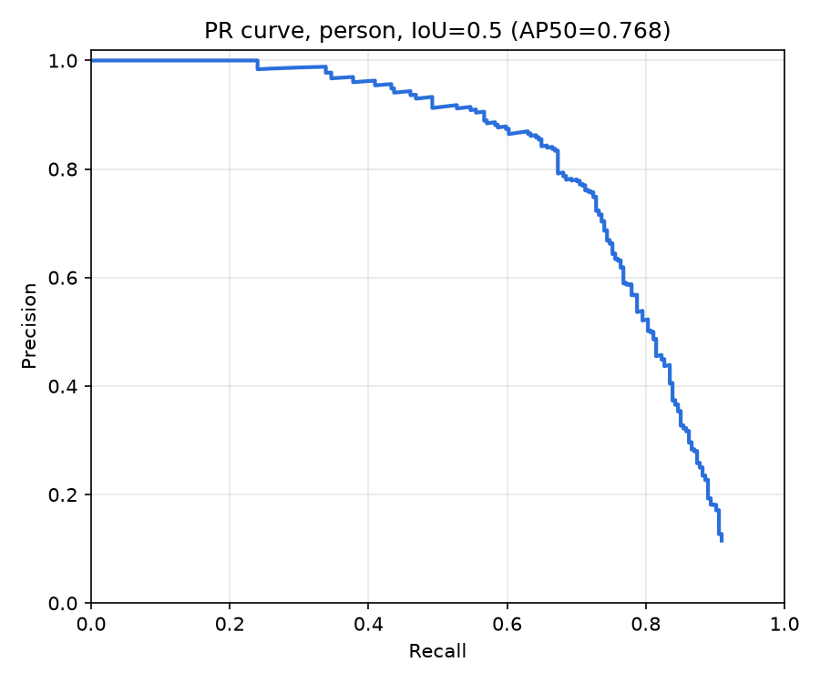

# Лабораторная работа №13. Object Detection: IoU, NMS и Precision–Recall

Модель: YOLOv8n (`yolov8n.pt`), данные: coco128 (128 изображений, 254 GT-бокса person). Класс для PR-анализа: **person (0)**.

Запуск: `python lab13.py`. Скрипт создаёт `pr_curve.png`, `nms_table.csv`, `predictions.csv` и папку `errors/`.

## Результаты пунктов 3 и 6

**Пункт 3.** A=(10,20,70,90), B=(40,50,100,110):

```
iou_xyxy(A, B)   = 0.1818
iou_matrix(A, B) = 0.1818
```

Пересечение 30×40 = 1200, площадь A = 4200, площадь B = 3600, объединение = 6600, IoU = 1200/6600 ≈ 0.1818.

**Пункт 6.** Боксы A=(10,20,110,120), B=(10,20,163.85,120), C=(79.23,20,163.85,120), confidence 0.95 / 0.85 / 0.70:

```
IoU(A,B) = 0.6500, IoU(A,C) = 0.2000, IoU(B,C) = 0.5500
После NMS(thr=0.5) остались: ['A', 'C']
Precision: [1.0, 0.5, 0.667, 0.75, 0.6]
Recall:    [0.25, 0.25, 0.5, 0.75, 0.75]
```

A оставлен как самый уверенный. B удалён, потому что IoU(A,B)=0.65 > 0.5. C остался, потому что IoU(A,C)=0.20. Большое IoU(B,C)=0.55 ни на что не влияет: B к этому моменту уже удалён.

Сравнение `greedy_nms` с `torchvision.ops.nms` (thr=0.5) на настоящих predictions: индексы совпали на всех 128 изображениях.

## Таблица NMS (person, conf ≥ 0.25, IoU matching 0.5)

| NMS IoU thr | Boxes before | Boxes after | Precision | Recall |
|---|---|---|---|---|
| 0.3 | 1512 | 189 | 0.8783 | 0.6535 |
| 0.5 | 1512 | 192 | 0.8698 | 0.6575 |
| 0.7 | 1512 | 200 | 0.8400 | 0.6614 |
| 0.9 | 1512 | 284 | 0.5951 | 0.6654 |

Чем выше порог NMS, тем больше дубликатов переживает подавление. Precision при этом падает: каждый дубликат становится FP. Recall растёт совсем немного, на величину рядом стоящих людей, которых низкий порог подавлял.

## Свои AP vs ultralytics (`model.val`)



| | AP50 | AP50-95 |
|---|---|---|
| Своя реализация (NMS 0.7, all-point) | 0.7683 | 0.5371 |
| ultralytics `model.val` | 0.7637 | 0.5330 |

Разница ~0.005. Откуда она берётся:
- **Интерполяция.** У меня all-point interpolation (площадь под огибающей PR). Ultralytics считает AP по 101 точке (COCO-стиль), это даёт немного другую площадь.
- **Предобработка.** `model.val` прогоняет изображения батчами с rect-letterbox и другим паддингом, а `predict` обрабатывает их по одному. Боксы и confidence получаются чуть разными.
- **NMS и лимиты.** В val используется встроенная NMS (iou=0.7, `max_det=300` по всем классам после NMS). У меня встроенная NMS отключена (iou=1.0), поэтому лимит в 300 боксов срабатывает ещё до NMS, а NMS я применяю сам и только к person.
- **Сопоставление.** Ultralytics сопоставляет predictions с GT внутри изображения по матрице IoU для каждого порога. У меня сопоставление жадное в глобальном порядке по confidence. На спорных случаях результат может отличаться.

## Разбор ошибок (conf ≥ 0.25, NMS 0.5)

Всего 25 FP и 87 FN. Картинки лежат в `errors/`: GT зелёным, predictions красным, разбираемый бокс выделен толстой рамкой.

| # | Изображение | Бокс | conf | Лучший IoU | Причина |
|---|---|---|---|---|---|
| FP1 | 000000000208.jpg | [43,201,236,480] | 0.851 | 0.00 | Игрушечный динозавр стоит вертикально, силуэт с «руками» похож на человека |
| FP2 | 000000000531.jpg | [137,400,207,480] | 0.743 | 0.00 | Тень фотографа на корте: человеческий силуэт без самого человека |
| FP3 | 000000000360.jpg | [240,136,315,198] | 0.719 | 0.415 | Сноубордист найден, но бокс захватил доску и стал слишком большим, IoU < 0.5 (ошибка локализации) |
| FP4 | 000000000382.jpg | [494,223,530,252] | 0.653 | 0.00 | Тёмный камень на снегу, мелкий и контрастный, похож на далёкую фигуру |
| FP5 | 000000000257.jpg | [470,327,481,356] | 0.619 | 0.00 | Узкий красный объект вдали в толпе: либо неразмеченный человек, либо столбик (спорная разметка) |
| FN1 | 000000000443.jpg | [118,1,638,474] | — | 0.208 | Человек виден только частично (колени и руки под котом), модель нашла лишь фрагмент руки |
| FN2 | 000000000529.jpg | [26,98,298,294] | — | 0.357 | Девушка сильно перекрыта мотоциклистом, оба человека слились в один бокс |
| FN3 | 000000000397.jpg | [4,0,229,205] | — | 0.00 | Человек обрезан краем кадра и закрыт пиццей, видна только часть торса |
| FN4 | 000000000443.jpg | [2,153,146,464] | — | 0.00 | В кадре только ноги и руки, без головы и силуэта, модель их не распознала |
| FN5 | 000000000308.jpg | [46,15,209,281] | — | 0.495 | Плотная толпа: бокс есть, но смещён из-за перекрытия соседями, IoU 0.495 чуть ниже 0.5 |

## Контрольные вопросы

**1. Как геометрически вычисляется IoU и что происходит при отсутствии пересечения?**
Пересечение двух axis-aligned прямоугольников тоже прямоугольник: левый верхний угол равен `max` от левых верхних углов, правый нижний равен `min` от правых нижних. Его площадь `max(0, x2-x1) * max(0, y2-y1)`. IoU равен этой площади, делённой на площадь объединения `areaA + areaB - inter`. Если боксы не пересекаются, `x2-x1` или `y2-y1` отрицательны, `max(0, ·)` обнуляет пересечение, и IoU = 0. `1e-12` в знаменателе защищает от деления на ноль у вырожденных боксов. IoU = 0 никак не различает соседние и далёкие боксы, поэтому для обучения иногда используют GIoU/DIoU.

**2. Почему NMS является жадным алгоритмом и в каких сценах она может ошибаться?**
На каждом шаге NMS берёт локально лучший бокс (максимальный confidence) и окончательно удаляет всех его соседей с IoU > thr. Решение не пересматривается, глобальная оптимальность набора не проверяется. Где она ошибается:
- плотные толпы и перекрытые объекты: второй настоящий объект с IoU > thr удаляется (FN2, FN5);
- высокий порог: дубликаты одного объекта выживают и дают FP (строка 0.9 в таблице);
- самый уверенный бокс локализован хуже соседа: остаётся худший (FP3);
- class-wise NMS не подавляет один объект, найденный под разными классами.

**3. Участок своего NMS: порядок сортировки и удаления**

```python
def greedy_nms(boxes, scores, thr):
    boxes = np.asarray(boxes, dtype=np.float64)
    order = np.argsort(-np.asarray(scores), kind="stable")
    keep = []
    while len(order) > 0:
        best = order[0]
        keep.append(int(best))
        rest = order[1:]
        ious = iou_matrix(boxes[best], boxes[rest])[0]
        order = rest[ious <= thr]
    return np.array(keep, dtype=np.int64)
```

1. `order`: индексы боксов по убыванию confidence (`argsort` от `-scores`, stable, чтобы при равных score порядок был детерминированным).
2. Первый элемент `order` (самый уверенный из оставшихся) добавляется в `keep`.
3. Векторизованно считается IoU этого бокса со всеми остальными кандидатами.
4. Удаляются кандидаты с IoU > thr. Остальные сохраняют порядок по убыванию confidence и становятся новым `order`.
5. Цикл повторяется, пока кандидаты не кончатся. `keep` возвращается в порядке убывания confidence, как у `torchvision.ops.nms`.
